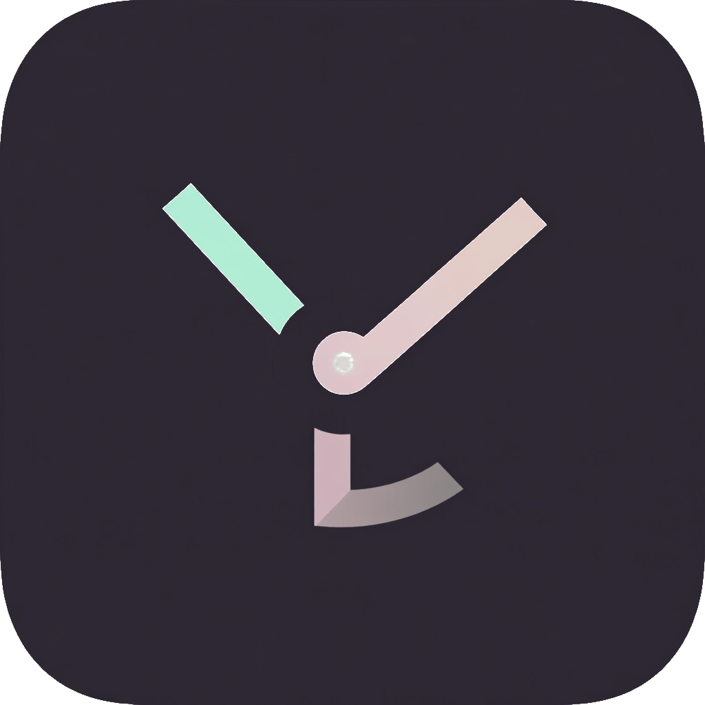
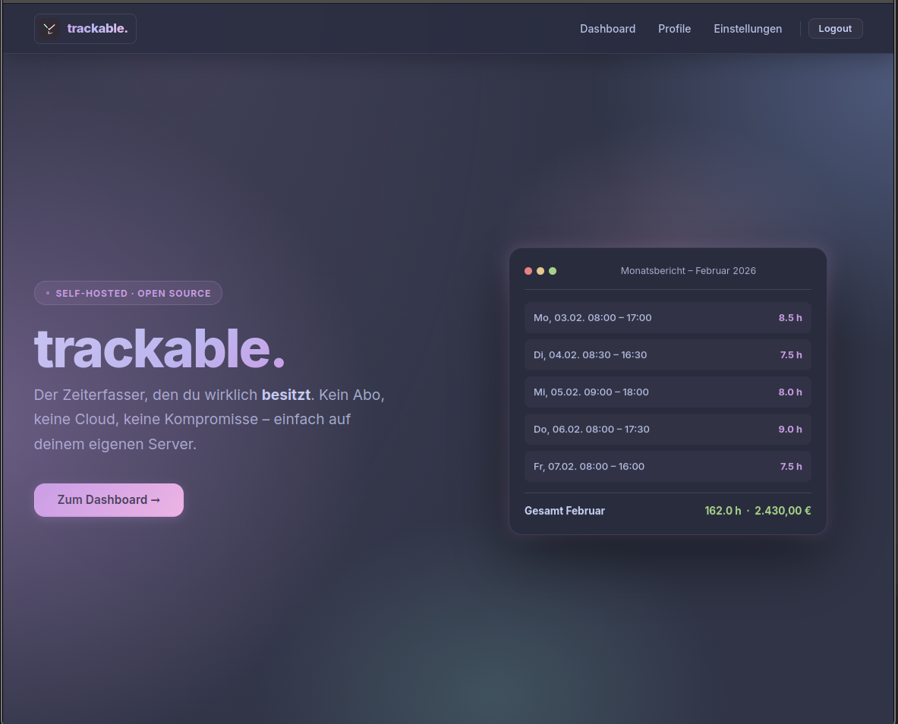
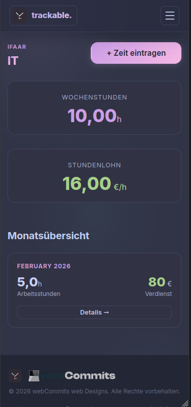

<div align="center">
  
  <h1>trackable.</h1>
  <p><strong>Simple, self-hosted time tracking &mdash; as a PWA.</strong></p>
  <p>
    
    
    
    
    
  </p>
</div>

---

## Screenshots

<div align="center">
  
  <br/><br/>
  
</div>

---

## Features

### Time tracking
- **📱 PWA** — Installable on iOS, Android, and desktop directly from the browser
- **⏰ Time tracking** — Quickly log start time, end time, breaks, and optional activity notes per day
- **⏱ Live Timer** — Start/Pause/Resume/Stop timer with one click; automatically creates time entries
- **⏱ Timer-only mode** — Restrict employees to timer-only tracking (optional per organization); managers retain full CRUD access
- **🗂 Multiple profiles** — Separate tracking for different clients or jobs, with edit and delete support
- **📊 Monthly overview** — Automatic calculation of total hours, target hours (Soll-Stunden), and running balance (Zeitkonto) per profile

### Exports
- **📄 PDF export** — Export monthly tables as landscape PDFs, fully translated (EN/DE); uses Web Share API on mobile devices to trigger native share sheet (AirDrop, Messages, Mail) instead of directly opening the PDF
- **📊 CSV export** — Export monthly time entries as semicolon-separated CSV, Excel-compatible (BOM)

### Business features
- **🏖 Vacation tracking** — Log vacation periods per profile; workdays are calculated automatically (Mon–Fri, excluding public holidays)
- **🎌 Public holiday management** — Configure public holidays via Django Admin; they are automatically excluded from vacation workday counts
- **💰 Time account (Zeitkonto)** — Automatic monthly calculation of target hours (Soll-Stunden) vs. actual hours with a running plus/minus balance; configurable weekly target hours per employee
- **🔒 Internal profile notes** — Attach private notes to each profile (e.g. contract details, department, payroll hints) — visible only to the account owner
- **📝 Time entry notes** — Add a short activity description to each time entry

### Organizations & teams
- **🏢 Organizations** — Create an organization and add employees as a manager
- **👤 Employee accounts** — Managers set a temporary password; employees log in immediately — no email confirmation needed; Profile is auto-created upon adding an employee
- **📊 Manager dashboard** — View all employees' profiles, monthly hours, target hours, and balance at a glance
- **👁 Read-only oversight** — Managers see employee time entries, vacation, target hours, and earnings without edit/delete controls
- **🔑 Role-based access** — Two roles: manager (oversight + employee management) and employee (personal tracking)
- **📅 Team calendar** — Shared weekly calendar per organization; all members can view, create, and edit events with color-coding, drag-and-drop via SortableJS, and an inline modal editor
- **🎨 Company branding (White-Label)** — Replaceable logo in the navbar, favicon, Apple Touch Icon, primary/accent colors, and custom CSS per organization — configured by managers at `/org/branding/`

### System
- **🔐 Registration with email confirmation** — New users register and confirm via email link; accounts stay inactive until confirmed
- **📧 Email test tool** — Send test emails from the admin panel (`/admin/email-test/`) to verify SMTP configuration; shows current settings and error details
- **📧 Monthly email reports** — Automated summary email on the last day of each month (includes PDF attachment)
- **🔐 Authentication** — Login, password reset, and email confirmation
- **💾 Automatic backups** — Weekly SQLite database backups
- **🌍 English & German** — Auto-detects browser language; English by default, German when device locale is `de`
- **🎨 Catppuccin design** — Clean, mobile-first dark theme with company branding support

---

## Tech Stack

| Layer | Technology |
|---|---|
| Backend | Django 5.0, Gunicorn |
| Frontend | Django Templates, CSS3, Vanilla JS |
| Database | SQLite (persistent Docker volume) |
| Static files | WhiteNoise (served directly via Gunicorn) |
| PDF | ReportLab |
| CSV | Python stdlib `csv` (semicolon-separated, Excel-compatible BOM) |
| Email | Django SMTP with html2text |
| Hosting | Docker, Docker Compose, Coolify |
| PWA | Web App Manifest |

---

## Self-Hosting with Docker

### Prerequisites

- [Docker](https://docs.docker.com/get-docker/) and Docker Compose
- A reverse proxy (Nginx, Caddy, Traefik) &mdash; **required in production**
- A domain name (for HTTPS)

### Which compose file to use?

- **`docker-compose.prod.yaml`**: For Coolify deployments OR standalone with manual reverse proxy (Nginx, Caddy)
- **`docker-compose.standalone.yaml`**: For standalone deployments with Traefik (automatic SSL via Let's Encrypt)

### 1. Clone the repository

```bash
git clone https://github.com/yourname/trackable.git
cd trackable
```

### 2. Configure environment

**For Coolify:**
Set environment variables directly in the Coolify UI when configuring your service. You must set all required variables listed in the [Environment Variables](#environment-variables) table below. No `.env` file needed.

**For Standalone Docker Compose:**
```bash
cp .env.example .env
```

Edit `.env` and set at minimum:

```env
# Generate a secure key:
# python -c "from django.core.management.utils import get_random_secret_key; print(get_random_secret_key())"
SECRET_KEY=your-secret-key-here

DEBUG=False
SUBDOMAIN=trackable
DOMAIN_NAME=yourdomain.com
ALLOWED_HOSTS=trackable.yourdomain.com

EMAIL_HOST=smtp.yourprovider.com
EMAIL_HOST_USER=you@yourdomain.com
EMAIL_HOST_PASSWORD=your-smtp-password
DEFAULT_FROM_EMAIL=noreply@trackable.yourdomain.com
```

### 3. Start the container

**For Coolify:**
Deploy through the Coolify UI — environment variables are passed automatically. Configure your domain in the Coolify domain settings.

**For Standalone Docker Compose:**

With Traefik (automatic SSL):
```bash
docker-compose --env-file .env -f docker-compose.standalone.yaml up -d --build
```

Without Traefik (manual reverse proxy):
```bash
docker-compose --env-file .env -f docker-compose.prod.yaml up -d --build
```

On startup the container automatically runs `migrate`, `collectstatic`, and `compilemessages`.

### 4. Reverse proxy

**For Coolify:**
Coolify's Traefik proxy handles SSL and routing automatically based on the domain you configure in the UI.

**For Standalone Docker Compose:**

- **With Traefik**: Use `docker-compose.standalone.yaml` which includes pre-configured Traefik labels for automatic routing and SSL. Set `SUBDOMAIN` and `DOMAIN_NAME` in your `.env` file.

- **Without Traefik**: Use `docker-compose.prod.yaml` and configure your own reverse proxy. A production-ready Nginx config is included at `nginx/trackable.conf` (TLS, HSTS, rate limiting, gzip).

> Static files are served directly by Gunicorn via WhiteNoise — no separate static file location in the reverse proxy needed.

### 5. Create the first user

Users can **self-register** at `/accounts/register/` — they will receive a confirmation email and must click the link to activate their account. Email must be configured (see step 2) for this to work.

Alternatively, create a superuser for admin access:

```bash
docker exec -it trackable-app python manage.py createsuperuser
```

Then open `https://yourdomain.com/admin/` to:
- Add and manage **public holidays** (used to calculate accurate vacation workday counts)
- Review or edit any data directly
- Test your email configuration via the **Email Test** page at `/admin/email-test/`

### 6. Test your email setup

Before relying on email features (registration confirmation, password resets, monthly reports), verify your SMTP configuration works:

1. Open `/admin/email-test/` in your browser (requires staff access)
2. Enter a recipient email address and click **Send test email**
3. Check the inbox — if the email arrives, your configuration is correct
4. If it fails, the page shows the error details and your current email settings (host, port, TLS, from address)

### 7. Set up an organization (for business use)

Any registered user can create an organization at `/org/create/` or through the **Management panel** at `/manage/`:

1. Click **"Create organization"** in the management panel or at `/org/create/`, and enter a name — you become the **manager**
2. Add employees via **"Add employee"** — fill in their name, email, and a temporary password
3. Employees log in with the temporary password and start tracking time
4. As manager, you see all employees' profiles, monthly hours, and earnings from the organization dashboard

> Individual users can continue using Trackable without an organization — nothing changes for them.

### Updating

```bash
git pull
docker-compose -f docker-compose.prod.yaml up -d --build
```

Migrations, static files, and translations are applied automatically on rebuild.

> **Important for existing instances:**  
> This update introduces a setup wizard. Until the instance is marked as configured, anonymous visitors may be redirected to `/setup/`. After the update, either complete the setup wizard once as an admin, or run the following command inside the app container to skip the wizard for an already-configured instance:
>
> ```bash
> docker exec -it trackable-app python manage.py shell -c "from trackable.core.models import SiteConfiguration; c = SiteConfiguration.get(); c.setup_completed = True; c.save()"
> ```
>
> Existing logged-in users and admin accounts are not affected.
>
> Only the account-creation step (step 1) is reachable before an admin exists; the second configuration step always requires being logged in as that admin. On a public-facing first deploy, you can additionally set the `SETUP_TOKEN` env var so step 1 itself requires a secret token (passed as `?token=...`) before anyone can create the first admin account.

---

## Database Backups

### Manual Backup

Create an immediate backup of your SQLite database:

```bash
# Copy database from container to host
docker exec trackable-app cp /app/data/db.sqlite3 /tmp/db_backup_$(date +%Y%m%d_%H%M%S).sqlite3

# Download to your local machine (optional)
docker cp trackable-app:/app/data/db.sqlite3 ./db_backup_$(date +%Y%m%d).sqlite3
```

### Automated Backups with Cron

The built-in `backup_db` management command creates backups automatically. Configure the schedule via `.env`:

```env
BACKUP_SCHEDULE=weekly        # Options: daily, weekly
BACKUP_FILENAME=db_backup.sqlite3
```

#### Automated Host Backups (recommended)

For a complete, automated backup of the database **and** media uploads (logos, favicons, etc.), use the included generic backup script:

1. **Copy the script to your host:**

```bash
mkdir -p /opt/trackable
cp scripts/backup.sh /opt/trackable/backup.sh
chmod +x /opt/trackable/backup.sh
```

2. **Adjust the configuration** at the top of `/opt/trackable/backup.sh`:

```bash
PROJECT_NAME="trackable"
BACKUP_DIR="/opt/trackable/backups"
DB_CONTAINER_PATH="/app/data/db.sqlite3"
MEDIA_CONTAINER_PATH="/app/media"
BACKUP_MEDIA=true
RETENTION_DAYS=30

# For Coolify: set your Coolify project name
COOLIFY_PROJECT_NAME=""

# For Docker Compose: set the container name filter
CONTAINER_NAME_FILTER="trackable-app"
```

> For **Coolify** deployments, set `COOLIFY_PROJECT_NAME` to the project name shown in the Coolify UI and `CONTAINER_NAME_FILTER` to a string that matches your app container (e.g. `django` or `trackable`).
>
> For **plain Docker Compose** deployments, leave `COOLIFY_PROJECT_NAME` empty and set `CONTAINER_NAME_FILTER` to your app container name (usually `trackable-app`).

3. **Add a cron job** (`crontab -e`):

```cron
# Daily backup at 2:00 AM
0 2 * * * /opt/trackable/backup.sh

# Or weekly on Sundays at 3:00 AM
0 3 * * 0 /opt/trackable/backup.sh
```

4. **Verify backups**:

```bash
ls -la /opt/trackable/backups/db/
ls -la /opt/trackable/backups/media/
```

The script keeps backups for `RETENTION_DAYS` days and writes a log to `/opt/trackable/backups/backup.log`.

> 💡 **Tip**: Sync the backup directory to cloud storage (e.g., rclone, rsync, restic) for off-site backups.

### Coolify

trackable. is fully compatible with [Coolify](https://coolify.io):

1. Add a new resource → Docker Compose
2. Point it at this repository
3. Set compose file to `docker-compose.prod.yaml`
4. Set port to `8000`
5. Add all environment variables from the table below
6. Deploy — Traefik handles SSL automatically

---

## Local Development

### With Docker (recommended)

```bash
make dev
```

App runs at `http://localhost:8000`. Useful Makefile commands:

| Command | Description |
|---|---|
| `make dev` | Start dev server with live reload |
| `make logs` | Follow container logs |
| `make shell` | Django shell inside container |
| `make migrate` | Run database migrations |
| `make test` | Run test suite |

### Without Docker

```bash
python -m venv .venv
source .venv/bin/activate
uv pip install -r pyproject.toml

cp .env.example .env
# set DEBUG=True in .env

python manage.py migrate
python manage.py compilemessages
python manage.py runserver
```

---

## Environment Variables

**Coolify users:** All variables below must be set in the Coolify UI. Copy them from this table and configure them in your service's Environment Variables section.

| Variable | Default | Description | Required for Coolify? |
|---|---|---|---|
| `SECRET_KEY` | &mdash; | Django secret key (required) | **Yes** |
| `DEBUG` | `False` | Set `True` for development only | Yes (set to `False`) |
| `ALLOWED_HOSTS` | &mdash; | Comma-separated list of allowed domains | **Yes** |
| `EMAIL_HOST` | `localhost` | SMTP host | Yes (for email features) |
| `EMAIL_PORT` | `587` | SMTP port | Yes (if using email) |
| `EMAIL_USE_TLS` | `True` | Use STARTTLS | Yes (if using email) |
| `EMAIL_HOST_USER` | &mdash; | SMTP username | Yes (if using email) |
| `EMAIL_HOST_PASSWORD` | &mdash; | SMTP password | Yes (if using email) |
| `DEFAULT_FROM_EMAIL` | &mdash; | From address for outgoing mail | Yes (if using email) |
| `BACKUP_SCHEDULE` | `weekly` | Backup frequency (`daily` / `weekly`) | No (optional) |
| `BACKUP_FILENAME` | `db_backup.sqlite3` | Backup file name | No (optional) |
| `MONTHLY_EMAIL_TIME` | `23:59` | Time to send monthly reports (HH:MM) | No (optional) |
| `MONTHLY_REPORT_DAY` | &mdash; (empty) | Day of the month (1-28) the monthly report is sent on. Empty = send on the last day of the month, covering that calendar month (previous behavior). Set (e.g. `24`) to send on that day every month instead, covering the period since the day after that day in the previous month. Organization managers can also set an org-wide "monthly report copy" address under Branding settings, which receives a BCC (or becomes the only recipient, if the employee has notifications disabled) of every member's report. | No (optional) |
| `SUBDOMAIN` | `trackable` | Subdomain for Traefik routing | No (Standalone only) |
| `DOMAIN_NAME` | &mdash; | Base domain for Traefik routing (e.g., `example.com`) | No (Standalone only) |
| `SETUP_TOKEN` | &mdash; (empty) | Optional shared secret required to access the first-run setup wizard at `/setup/` | No (optional, recommended for public-facing first deploys) |
| `SERVE_MEDIA` | `True` | Whether Django itself serves `/media/` (uploaded org logos/favicons) when `DEBUG=False`. Set `False` if a reverse proxy serves media files instead | No (optional) |

---

## Internationalization

trackable. ships with **English** (default) and **German** translations.

Language is detected automatically from the `Accept-Language` header sent by the browser or device — no configuration needed. Set your OS or browser language to German and the interface switches automatically. PDF and CSV exports respect the active language as well.

---

## Business & Team Use

trackable. supports both individual freelancers and small businesses through its organization system.

### Organizations

Any user can create an organization at `/org/create/` and become its **manager**. Managers can then:

1. **Add employees** — Create accounts with a username, email, name, and temporary password. When creating an employee, managers can set the weekly working hours as well as optional contract start and end dates (e.g. for fixed-term contracts). Employees are active immediately and can log in right away. A profile is auto-created for them with the specified settings.
2. **View the dashboard** — See all employees at a glance with quick stats including their monthly target hours, actual hours, and balance (Zeitkonto).
3. **Inspect employee data** — Click into any employee to view their profiles, monthly hours, target hours, time account balance, and earnings. Drill down into a specific month to see a read-only table of time entries, vacation, and totals.
4. **Adjust target hours & contract dates** — Override the weekly target hours (Soll-Stunden) per employee directly from the profile detail page. Contract start and end dates can also be changed afterwards — the time account calculation respects both fields (working days before the start date or after the end date are excluded from target hour calculation).
5. **Remove employees** — Remove an employee from the organization. Their account and data remain intact.
6. **Company Branding** — Customize the look and feel at `/org/branding/`: replace the navbar logo, favicon, Apple Touch Icon, and set primary/accent colors or custom CSS for your organization.
7. **Team Calendar** — View and manage a shared weekly calendar at `/org/team-calendar/`. All members can create, edit, and delete color-coded events, and drag-and-drop them between days/times.

Employees see a minimal org page showing their membership. Their personal time-tracking experience (profiles, entries, exports) is unchanged.

> A user can belong to at most one organization. Individual users without an organization see no org UI at all — the app works exactly as before.

### Time tracking modes

Organizations can operate in two modes, configured at the org dashboard:

| Mode | Description |
|------|-------------|
| **Classic** (default) | All users can manually add, edit, and delete time entries |
| **Restricted (Timer-only)** | Employees can only use the live timer (start/pause/stop); manual entry add/edit is blocked. Managers retain full CRUD access to all time entries. |

### Registration flow

| Method | Email confirmation | Account active? | Who creates it? |
|---|---|---|---|
| Public registration (`/accounts/register/`) | Required | After clicking confirmation link | The user themselves |
| Manager creates employee | Not required | Immediately | An org manager |

### Public holidays

Configure country- or region-specific public holidays once via Django Admin (`/admin/core/holiday/`). They are automatically excluded from vacation workday calculations across all profiles — no manual adjustment needed.

### Profile internal notes

Each profile supports a private **Internal notes** field — visible only to the logged-in owner. Use it for contract details, department assignments, payroll notes, or any other context that should travel with the profile but not appear in exports.

### Time account (Zeitkonto)

Each employee profile automatically calculates a monthly time account:

- **Target hours (Soll-Stunden)**: Derived from the profile's weekly working hours (`weekly_hours`) or an optional per-employee override (`weekly_target_hours`) set by managers. If the profile has a **contract start date**, only working days on or after that date are counted; if a **contract end date** is set, only working days up to that date are counted. This allows accurate pro-rata target calculations for employees who start or leave mid-month.
- **Actual hours**: Sum of all time entries and vacation workdays in the month.
- **Balance**: Actual hours minus target hours — shown in green (positive) or red (negative) directly on the profile and employee detail pages.

Managers can override the weekly target hours per employee from the employee profile detail page. Contract start and end dates are also editable there — set during employee creation and changeable at any time.

### Company Branding

Managers can customize the look and feel of trackable for their organization at `/org/branding/`:

- **Logo** — Upload a custom logo (180×40 px, PNG/SVG) to replace the trackable logo in the navbar
- **Favicon** — Custom browser tab icon
- **Apple Touch Icon** — Custom icon for the iOS home screen
- **Primary color** — Overrides button and badge colors
- **Accent color** — Overrides link and secondary accent colors
- **Custom CSS** — Add custom CSS rules for fine-tuning (loaded after all standard styles)

All branding changes are applied instantly and only affect the current organization's members.

### Team Calendar

Each organization has a shared weekly calendar at `/org/team-calendar/`. All organization members can:

- View events for the selected week (navigate with prev/next buttons)
- Create events by clicking an empty time slot or using the "Add Event" button
- Edit events via an inline modal (title, notes, start time, duration, color)
- Drag and drop events between days and time slots (SortableJS)
- Delete their own events; managers can delete any event

Events are color-coded with 6 preset colors and show the creator's name.


### Exports at a glance

| Format | Location | Use case |
|---|---|---|
| PDF (landscape A4) | Monthly table → "Export PDF" | Filing, payroll submission; uses Web Share API on mobile for native sharing (AirDrop, Messages, Mail) |
| CSV (semicolon, BOM) | Monthly table → "Export CSV" | Excel, DATEV, further processing |

---

## License

[MIT](LICENSE) &copy; 2026 webCommits web Designs

---

<div align="center">
  <br/>
  <p>If trackable. saves you time, consider buying me a coffee ☕</p>
  <a href="https://paypal.me/dcmbrbeats">
    
  </a>
  <br/><br/>
  <a href="https://www.webcommits.info">
    
  </a>
  <br/>
  <sub>Built with ❤ by <a href="https://www.webcommits.info">webCommits</a></sub>
</div>
